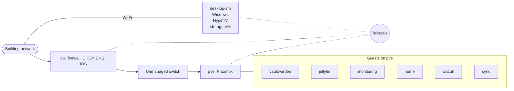

# homelab
A home network I built from spare hardware to learn IT and security, with notes
on what went into it and what broke.

## Overview
This is the network I run at home, built from two repurposed laptops, a Windows
desktop, and an unmanaged switch. One laptop is the gateway, and it handles
DHCP, DNS, the firewall, and intrusion detection for everything behind it. The
other runs Proxmox, which currently hosts six services: a password manager,
media streaming, note syncing, monitoring, a SIEM, and a dashboard. DNS leaves
the network encrypted, remote access goes through Tailscale with no open
inbound ports, and the machines send their logs to Wazuh so I can see what each
is doing. It's a single-person lab built to practice the work and learn IT and
security concepts.

## What this demonstrates
- **Networking fundamentals:** DHCP reservations and DNS on a Linux gateway,
with the firewall written in nftables and DNS forwarded over TLS.
- **Segmentation and access control:** two guests blocked from each other and
tested in both directions, SSH by key only on the gateway, hypervisor, storage,
and desktop hosts, and remote access through Tailscale with tag-based rules.
- **Monitoring and incident response:** Wazuh collecting logs from each of the
hosts, Suricata watching the gateway, and written records of problems I
encountered and investigated.
- **Windows and Linux administration:** a Windows 11 desktop running a Hyper-V
VM and a Wazuh agent, alongside Debian and Proxmox hosts that I keep patched.
- **Backup and recovery:** a live backup restored into a fresh VM, with the
steps recorded in runbooks and the failure points I ran into.
- **Documentation:** decision records, runbooks, and a state file that tracks
what changed and why.

## Architecture

Everything behind the gateway sits on its own network. The gateway is the only
path between the lab and the building network, so it's where DHCP, DNS, the
firewall, and intrusion detection live. Two of the guests are firewalled from
each other, tested in both directions, and remote access goes over Tailscale
(dashed lines) instead of open ports.

## Hardware and services

| Host | Hardware | Role |
|---|---|---|
| `gw` | ThinkPad T480, i5-8350U, 16 GB, 1 TB SSD | Debian gateway: firewall, DHCP, DNS, intrusion detection |
| `pve` | IdeaPad Slim 3, Ryzen 7 5825U, 16 GB, 512 GB SSD | Proxmox hypervisor for the lab's guests |
| `desktop-sm` | Ryzen 7 7800X3D, 32 GB, Windows 11 Pro | Workstation, also runs the `storage` VM in Hyper-V |
| Switch | TP-Link TL-SG605, 5-port unmanaged | Connects `gw` and `pve` |

| Service | Runs on | What it does |
|---|---|---|
| `vaultwarden` | VM on `pve` | Password manager |
| `jellyfin` | LXC on `pve` | Media streaming |
| `monitoring` | LXC on `pve` | Metrics and dashboards |
| `home` | LXC on `pve` | Dashboard linking the services |
| `wazuh` | VM on `pve` | SIEM collecting logs from the hosts |
| `sync` | LXC on `pve` | Note syncing |
| `storage` | VM on `desktop-sm` | NFS file storage for the lab |

## Incidents and fixes
### Docker's default network range collided with the building network
Before I installed Proxmox, the IdeaPad ran a few trial Docker containers, and
the gateway suddenly couldn't ping or SSH to it even though it could still
reach the internet. Docker had created virtual networks one after another until
one landed on the same range the building network uses, so replies headed for
the gateway went into a virtual bridge. `ip route get` showed which route the
kernel was really choosing. I fixed it by designing the lab's own network
outside every range Docker hands out. ARP still worked while ping failed, which
pointed at routing, not cabling.

### A disk-usage alarm on the SIEM pointed at the wrong cause
My first theory was that alert data would fill the disk within weeks. I checked
with an unprivileged `du`, which hid about 18 GB because it couldn't read
root-owned folders. Run with `sudo`, `du` showed the real cause: a 12 GB
vulnerability-detector feed cache. I still added a 90-day retention policy on
the alert index and cleaned up stale file handles. Measuring with enough
privilege came before choosing a fix.

### A boot-order race hung the Proxmox shutdown
`pve` mounts file storage from the `storage` VM over Tailscale. At boot, the
mount ran before Tailscale's name service existed and failed. At shutdown,
Tailscale stopped before the unmount, so the mount waited forever on an
unreachable server and I had to cut power. I declared the dependencies in
systemd, added a small unit that waits until Tailscale is actually running,
ordered the guests after the mount, and proved it with two clean reboots.

## Security posture
The lab sits behind a building network I don't control, so I treat that network
as untrusted. The main concerns are other devices on the building network, a
compromised device inside the lab, and my own mistakes. I'm not defending
against a determined attacker with physical access to the hardware.

- **Perimeter:** the gateway's firewall drops unsolicited inbound traffic by
default.
- **Name resolution:** DNS leaves the network encrypted, which I checked with a
packet capture.
- **Hosts:** SSH keys only on the gateway, hypervisor, storage, and desktop
hosts, and the machines are patched.
- **Remote access:** Tailscale only, with tag-based access rules and no open
inbound ports.
- **Isolation:** two of the guests are blocked from each other, tested in both
directions.
- **Detection:** Suricata on the gateway, Wazuh agents on all of the hosts.
- **Recovery:** a live backup restored into a fresh VM.

## Known gaps
- **The gateway is a single point of failure.** If `gw` goes down, the lab
loses its firewall, DHCP, and DNS. A spare gateway or a restorable image would
cut the downtime, and I haven't built either.
- **Backups stay on one site.** The backup is copied to a second machine, but
both sit in one place, so a fire or theft would take both. A separate drive
kept offline would fix that.
- **No VLANs.** The switch is unmanaged, so isolation comes from the Proxmox
firewall, not from the network. A managed switch would let me segment properly.
- **Firmware hardening is incomplete.** The gateway has no BIOS supervisor
password, and Secure Boot is off.
- **SSH hardening is incomplete.** The gateway, hypervisor, storage VM, and
desktop accept keys only. I audited one of the other guests, found it still
allowed password logins, and am working through the rest.

## How to read this repo
- **Quick overview:** read the Overview and the diagram.
- **How I troubleshoot:** read Incidents and fixes.
- **What isn't done yet:** read Known gaps.
- **Full detail:** the full working log (decision records and runbooks) is kept
in a private repository, the sanitized version will be added under `docs/` and
`examples/`

## Status
| Item | State |
|---|---|
| Lab | Running |
| Documentation | In progress |
| Last updated | 2026-10-15 |
